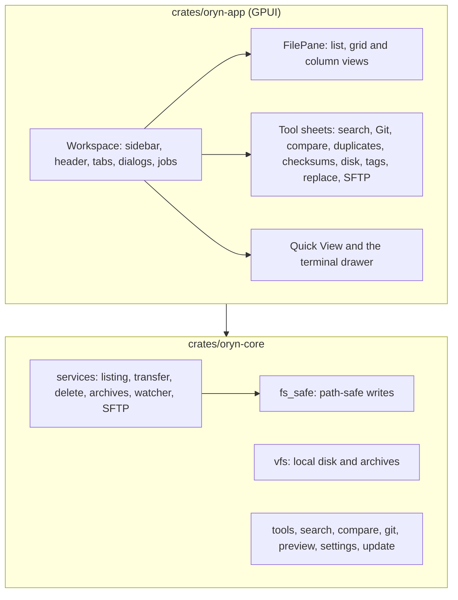

# Oryn architecture

Oryn is a native Rust app. The interface is drawn with [GPUI Kit](https://crates.io/crates/gpui-kit) on the GPU, with no WebView, HTML, CSS or JavaScript. The repository is one Cargo workspace with two crates.

## Crates

`crates/oryn-core` (edition 2021) has no UI code, so everything in it is unit tested:

- `services/` lists folders, copies and moves with progress, deletes or trashes, packs and unpacks archives, watches folders and talks to SFTP servers.
- `batch` runs multi-item operations (copy, move, trash, delete, compress, extract) and reports progress through `Progress`.
- `tools/` holds the logic behind each power tool: `find`, `repo` (Git), `dircmp`, `checksum`, `tags` and `textreplace`.
- `preview` sorts files into kinds, highlights code, parses Markdown and builds hex dumps for Quick View.
- `settings` stores preferences. `update` checks GitHub for a newer release, plans how to install it on this platform (`Plan`, `Target`), verifies the download against the release checksums and installs it through an `Installer`: the whole bundle on macOS, the portable `.exe` on Windows, and the binary from the `.tar.gz` on Linux.
- `fs_safe` resolves every write inside a root directory, so archive entries and remote names cannot escape it.

`crates/oryn-app` (edition 2024) is the GPUI interface:

- `workspace.rs` owns the window: the two pane stacks, tabs, the header and toolbar, settings, the command palette, the context menu, the job bar, the folder watcher and the update check. Its submodules under `workspace/` split these parts out.
- `pane.rs` is one file list with its cursor, selection, sorting, filter and the three views.
- `tools/` has one entity per power tool, hosted in a sheet by `workspace/tool_sheet.rs`. Slow work runs off the UI thread through `tools::run_bg`.
- `quick_view.rs` and `terminal.rs` (alacritty_terminal and portable-pty) are the overlays.
- `theme.rs` holds the six accent trays and the palette; `icons.rs` maps file types to Lucide and Oryn icons.

## Packaging and releases

`scripts/package.sh` builds the release binary and wraps it for the platform it runs on: an `.app` inside a `.dmg` on macOS, an NSIS installer and a portable `.exe` on Windows, and a `.deb` and `.tar.gz` on Linux. `.github/workflows/release.yml` runs it on all three platforms and uploads the results to a draft GitHub release named after the version in `Cargo.toml`. Run the workflow with `publish` on, or push a `v*` tag, to publish it. The macOS app is signed ad hoc unless the Developer ID secrets are set: `MACOS_CERTIFICATE_P12` (base64 of the .p12), `MACOS_CERTIFICATE_PASSWORD` and `MACOS_SIGNING_IDENTITY` sign it, and `APPLE_API_KEY_P8`, `APPLE_API_KEY_ID` and `APPLE_API_ISSUER` (an App Store Connect API key) notarize and staple the app and the `.dmg`. The script stops if the binary links to a library under `/opt/homebrew` or `/usr/local`, because users do not have it. SFTP uses `ssh2` with OpenSSL built in on macOS for the same reason.

## Performance (Linux, 2026-11-22)

Measured on a 4-core cloud VM under Xvfb with Mesa lavapipe (CPU Vulkan), release build.

| Check | Result |
| --- | --- |
| Builds against `gpui-kit = "=0.10.0"` | Yes, with Rust 1.100 |
| 100,050-row folder, listing time | 180 ms (3 runs: 182, 182, 179) |
| Scroll frame time, 100k rows vs 2k rows | 47.9 ms vs 46.7 ms; flat with list size |
| Idle memory (PSS), demo folders, 3 runs | 152 MiB (155,617 to 156,041 kB) |
| Idle memory (PSS), 100k-row folder | 180 to 189 MiB |
| Terminal (alacritty_terminal + portable-pty) | Shell, colours, cursor, resize |
| Accent trays from DESIGN.md | All six |

Frame times and memory include CPU rasterisation by lavapipe, which a real GPU does not pay. The same software-rendering setup measured Tauri at about 336 MiB PSS in HeyVasily/rust-desktop-comparison.
